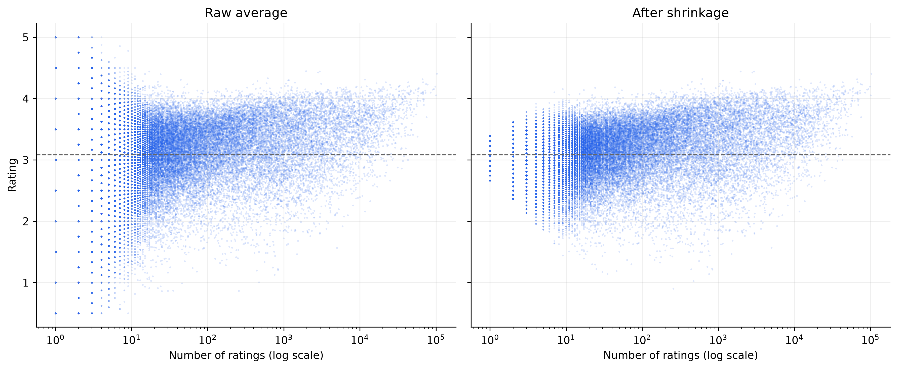

# Which films are really rated higher? Shrinkage on MovieLens 32M

Is a film with only a few 5-star ratings the best film ever made?

This project uses MovieLens 32M to separate films that are **genuinely rated higher** 
from films that **only look that way because only a few people rated them**, using 
DuckDB for the data work and a simple hierarchical (partial pooling) model for the ranking.

It is shown that, when ranked by raw average, the films that end up in the shrunk top 15 sat 
between 2 528th and 3 148th in ranking, behind more than 2 500 films that shrinkage pushes down.

## Summary

- MovieLens 32M has 32 million ratings of about 84 000 films, but most films have very
  few ratings: the median film has **5 ratings**, and **62% have fewer than 10**.
- Ranked by raw average, the top of the list is dominated by films with only a handful 
  of ratings, all of them 5 stars. In fact, 1 445 films have "perfect" 5-star average ratings.
- After shrinking each film's average towards the "typical" film, in proportion to how
  little evidence it has, the top 15 are then well-known, heavily-rated films
  (Planet Earth II, Band of Brothers, The Shawshank Redemption, The Godfather, Parasite).
- A film with one rating keeps only about 16% of its distance from the typical film’s average; 
  one with 1 000+ ratings keeps over 99%.

## Headline result



*Left: each dot is a film, plotted by its number of ratings and its raw average. Thin
films scatter widely. Right: the same films after shrinkage. Films with few ratings are
pulled towards the typical film; films with many ratings barely move.*

### Raw top 15

| title                                                   |   n |   mean_rating |   shrunk |   shrunk_rank |
|:--------------------------------------------------------|----:|--------------:|---------:|--------------:|
| Love, Kennedy (2017)                                    |   4 |         5.000 |    3.916 |           815 |
| Lonesome Dove Church (2014)                             |   3 |         5.000 |    3.784 |         1,975 |
| Sound of Christmas (2016)                               |   3 |         5.000 |    3.784 |         1,975 |
| David Attenborough's Tasmania (2018)                    |   3 |         5.000 |    3.784 |         1,975 |
| The Nagano Tapes (2018)                                 |   3 |         5.000 |    3.784 |         1,975 |
| ReMoved (2013)                                          |   3 |         5.000 |    3.784 |         1,975 |
| Genius on Hold (2013)                                   |   2 |         5.000 |    3.615 |         4,986 |
| Fatal Memories (1992)                                   |   2 |         5.000 |    3.615 |         4,986 |
| Placebo: Soulmates Never Die: Live in Paris 2003 (2004) |   2 |         5.000 |    3.615 |         4,986 |
| War Arrow (1954)                                        |   2 |         5.000 |    3.615 |         4,986 |
| About Sarah                                             |   2 |         5.000 |    3.615 |         4,986 |
| One Track Heart: The Story of Krishna Das (2013)        |   2 |         5.000 |    3.615 |         4,986 |
| My Last Year With The Nuns (2014)                       |   2 |         5.000 |    3.615 |         4,986 |
| Tammy and the Doctor (1963)                             |   2 |         5.000 |    3.615 |         4,986 |
| La muerte de Jaime Roldós (2013)                        |   2 |         5.000 |    3.615 |         4,986 |

NB: All 15 are tied at raw rank 1; the shrunk column shows where shrinkage eventually puts them.

### Shrunk top 15
| title                                       |       n |   mean_rating |   shrunk |   raw_rank |
|:--------------------------------------------|--------:|--------------:|---------:|-----------:|
| Planet Earth II (2016)                      |   1,956 |         4.447 |    4.444 |      2,528 |
| Planet Earth (2006)                         |   2,948 |         4.444 |    4.443 |      2,531 |
| Band of Brothers (2001)                     |   2,811 |         4.427 |    4.425 |      2,535 |
| Shawshank Redemption, The (1994)            | 102,929 |         4.405 |    4.405 |      2,539 |
| Cosmos                                      |     615 |         4.330 |    4.321 |      2,679 |
| Godfather, The (1972)                       |  66,440 |         4.317 |    4.317 |      2,682 |
| Parasite (2019)                             |  11,670 |         4.312 |    4.312 |      2,684 |
| Blue Planet II (2017)                       |   1,163 |         4.300 |    4.296 |      2,686 |
| Twin Peaks (1989)                           |   1,140 |         4.299 |    4.294 |      2,702 |
| Twelve Angry Men (1954)                     |     449 |         4.286 |    4.275 |      2,703 |
| 12 Angry Men (1957)                         |  21,863 |         4.265 |    4.265 |      2,711 |
| Usual Suspects, The (1995)                  |  67,750 |         4.265 |    4.265 |      2,712 |
| Godfather: Part II, The (1974)              |  43,111 |         4.264 |    4.264 |      2,713 |
| Over the Garden Wall (2013)                 |   1,397 |         4.264 |    4.260 |      2,714 |
| Seven Samurai (Shichinin no samurai) (1954) |  16,531 |         4.250 |    4.249 |      3,148 |

NB: Some entries are TV series or documentaries, which MovieLens includes alongside films.

## Method

Each film *j* has a true (latent) quality θⱼ that we never actually observe. Instead, we see the average of its nⱼ  ratings as the observable variable ȳⱼ.

We instead assume that:

- Films come from a common population: θⱼ ~ Normal(μ, τ²)
- A film's average is its true quality plus noise: ȳⱼ | θⱼ ~ Normal(θⱼ, σⱼ²/nⱼ)

Under this model, the posterior mean of θⱼ is the shrunk quality estimate:

```
shrunk_j = μ + w_j · (ȳ_j − μ),      w_j = τ² / (τ² + σ_j²/n_j)
```

`w_j` is the share of the observed spread that is real. It goes to 1 with many ratings
and towards 0 with few.

1. **σⱼ** (rating-to-rating noise) is the pooled within-film standard deviation, computed
   in SQL for four film-size buckets. It falls from about 1.08 for thin films to 0.95 for
   the most-rated.
2. **μ and τ²** are estimated from all films together by maximising the marginal
   likelihood ȳⱼ ~ Normal(μ, τ² + σⱼ²/nⱼ) (empirical Bayes). μ ≈ 3.08 and τ ≈ 0.48
   stars. A method-of-moments estimate agrees (τ² 0.231 vs 0.226).
3. **Shrinkage** is then applied film by film using the formula above.

The per-film summary is a sufficient statistic for θⱼ when σⱼ is known, which is why the
model runs on about 84,000 rows (`film_stats`) and not on 32 million ratings.

## Pipeline

| Step | File | What it does |
|---|---|---|
| 0 | `01_ingest.py`    | Loads the CSVs into DuckDB with explicit types |
| 1 | `02_checks.py`    | Data quality checks: no duplicate ratings or films, no orphan ratings, no nulls, valid rating values |
| 2 | `03_film_stats.py`| Builds `film_stats`, one row per film (n, mean, variance) |
| 3 | `04_analysis.py`  | σ by film size, empirical Bayes for μ and τ², shrinkage. Produces `figures/` and `results/` |

`explore.py` holds exploratory queries used along the way.

## Limitations

- **Normal approximation.** Ratings are bounded half-stars; averages of many ratings are
  close to Normal, but for films with one or two ratings it is a rough approximation.
- **σ is fixed, not inferred.** It is set from SQL by film-size bucket. Films with a single
  rating have no variance of their own and are assigned the σ of the 2–9 rating bucket.
- **One μ and one τ for all films.** Popular films are rated slightly higher on average
  (μ ≈ 3.22 for films with 20+ ratings vs 3.08 overall), so thin films may be shrunk a
  little too low. τ is similar across the two groups (0.213 vs 0.226).
- **Film-level only.** There are no user effects, so harsh or generous raters are not
  modelled, and the ratings come from self-selected MovieLens users.
- **Point estimates.** μ and τ are plug-in values; a full Bayesian model would carry their
  uncertainty through to every film.

## Reproduce

1. Download [MovieLens 32M](https://grouplens.org/datasets/movielens/32m/) from GroupLens
   and unzip it so that the files are at `data/ml-32m/ratings.csv` and `data/ml-32m/movies.csv`.

2. Install dependencies and run the pipeline:
   ```uv sync
   uv run python 01_ingest.py
   uv run python 02_checks.py
   uv run python 03_film_stats.py
   uv run python 04_analysis.py
   ```

## Data and licence

The data is the [MovieLens 32M dataset](https://grouplens.org/datasets/movielens/32m/)
from GroupLens. It is **not included** in this repository and must be downloaded from 
GroupLens using the above. Use of the data is subject to the GroupLens terms.

> F. Maxwell Harper and Joseph A. Konstan. 2015. The MovieLens Datasets: History and
> Context. *ACM Transactions on Interactive Intelligent Systems* 5, 4, Article 19.
> https://doi.org/10.1145/2827872

Code is released under the [MIT licence](LICENSE). The MovieLens data is not covered by this
licence and is subject to the GroupLens terms.

## Next steps

- Fit the full hierarchical model in NumPyro (non-centred), to propagate uncertainty in μ
  and τ and compare with the empirical Bayes values above.
- Let μ depend on log(n) to handle the popularity drift.
- Add tests for the pipeline checks.